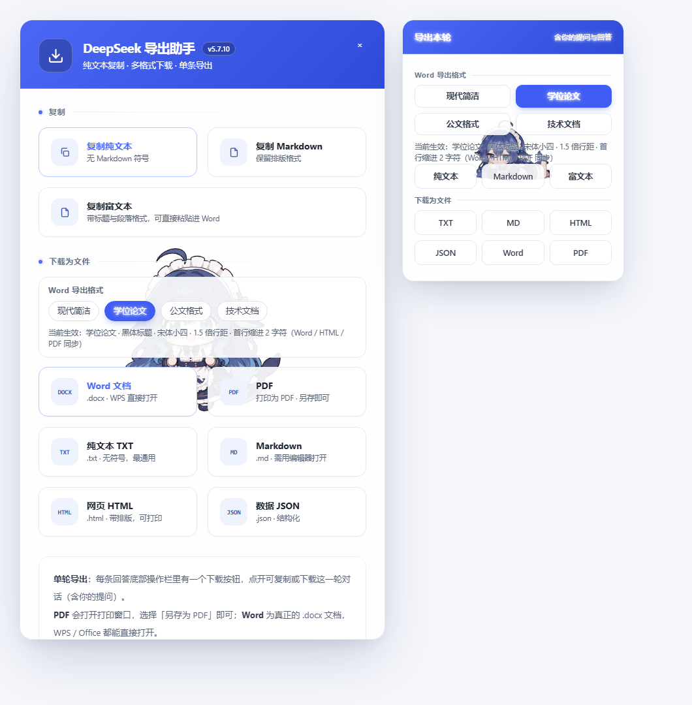
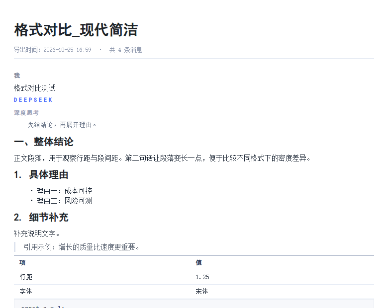
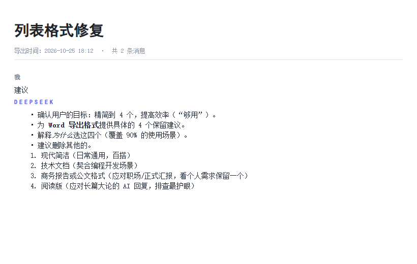

# DeepSeek 对话导出助手

> 油猴脚本 / Tampermonkey / Userscript · 适用于 [chat.deepseek.com](https://chat.deepseek.com)

把 DeepSeek 的整段对话**一键导出**，保留标题层级、代码块、表格，清除全部 Emoji。

## 为什么需要它

DeepSeek 自带的复制会把 Markdown 符号、表格边框、emoji 一起带走，粘到 Word 里格式全乱。这个脚本走**接口级数据提取**（不是扒 DOM），拿的是原始结构化数据，**你的提问内容 100% 准确、不会漏**。

## 功能

| 能力 | 说明 |
|---|---|
| 复制纯文本 | 不带 Markdown 符号，直接粘到 Word / 微信 |
| 复制 Markdown | 保留排版，适合写文档 |
| 复制富文本 | 带标题层级与表格，粘进 Word 不跑版 |
| 下载为文件 | TXT / Markdown / HTML / JSON / Word(docx) / PDF |
| 单条导出 | 每条回答旁有独立按钮，只导出这一轮（含你的提问） |
| 自动清除 Emoji | 导出内容干净，适合直接使用 |
| 多种排版样式 | 商务报告 / 学位论文 / 科技论文 / 现代简洁，导出前可切换 |

## 安装渠道

| 渠道 | 地址 | 说明 |
|---|---|---|
| **GitHub Raw** | [一键安装](https://cdn.jsdelivr.net/gh/xubbllanan-lab/deepseek-export-assistant@main/deepseek-export.user.js) | 官方源，指向最新版 |
| **OpenUserJS** | [脚本页](#) | 油猴生态，可搜索、可评分 |
| **GreasyFork** | [脚本页](#) | 全球油猴用户主站 |

> 在油猴脚本平台搜索时，直接搜「DeepSeek 对话导出助手」即可找到。

## 安装

### 方式一：一键安装（推荐）

1. 安装油猴管理器：Chrome / Edge 扩展商店搜索 **Tampermonkey**（或 **暴力猴**）。
2. 点击下方链接，油猴会自动弹出安装提示，点「安装」：

   ```
   https://cdn.jsdelivr.net/gh/xubbllanan-lab/deepseek-export-assistant@main/deepseek-export.user.js
   ```

3. 访问 [chat.deepseek.com](https://chat.deepseek.com)，右下角出现「DeepSeek 导出助手」按钮即安装成功。

> 脚本已内置 `@updateURL`，作者更新后你会**自动收到新版本**，无需手动重装。

### 方式二：手动下载

进入仓库，点文件 → 点右上角 **Raw** → 油猴自动安装。

| 文件 | 说明 |
|---|---|
| [`deepseek-export.user.js`](https://cdn.jsdelivr.net/gh/xubbllanan-lab/deepseek-export-assistant@main/deepseek-export.user.js) | **标准版**（推荐）体积小，Markdown 渲染库走 CDN |
| [`deepseek-export.offline.user.js`](https://cdn.jsdelivr.net/gh/xubbllanan-lab/deepseek-export-assistant@main/deepseek-export.offline.user.js) | **离线版** 渲染库已内联，零外部依赖，国内网络稳定 |

> 首次安装标准版后，渲染库从 jsDelivr CDN 加载；若网络受限导致排版异常，换装离线版即可。

## 使用

1. 打开任意 DeepSeek 对话页面。
2. 点右下角蓝色按钮打开面板。
3. 在「Word 导出格式」区选择排版样式，再点对应按钮导出。
4. 想只导出某一条回答，点该回答旁的单条导出按钮。

## 界面



<details>
<summary>宣传图（点击展开）</summary>


</details>

<details>
<summary>其他排版样式示例</summary>

**商务报告风格**


**列表层级渲染**


</details>

## 技术实现

- **接口级提取**：拦截 DeepSeek 的接口响应，读取结构化消息体，而不是从渲染后的 DOM 反推。因此长对话、代码块、表格、思考过程都能完整保留，提问内容不会丢失。
- **排版还原**：导出时套用与 DeepSeek 原生一致的排版规则，标题层级、列表嵌套、表格、代码块样式都对齐；四种预设风格可切换。
- **Word 导出**：生成真正的 `.docx`（OOXML），不是改后缀的伪文件，可直接在 Word 里继续编辑。
- **PDF 导出**：基于打印排版引擎，矢量文本、可选中复制，不是图片截图。
- **本地处理**：全部在浏览器内完成，不上传任何数据到第三方服务器。

## 常见问题

**Q：点了按钮没反应？**
按 F12 打开控制台，截图红色报错反馈即可。

**Q：能导出之前的对话吗？**
可以，只要对话还在当前账号的历史记录里，切换到那个会话再导出。

**Q：会泄露我的聊天记录吗？**
不会。脚本完全在本地运行，不发送任何数据到外部服务器。

**Q：和官方自带的复制有什么区别？**
官方复制保留原始 Markdown 符号，粘到 Word 里表格会散、代码块不带样式。本脚本提供三种复制形态（纯文本 / Markdown / 富文本），并能直接产出 Word 和 PDF 文件。

## 许可

[MIT License](LICENSE) © 2026 xubbllanan-lab

## 相关链接

- 问题反馈与新需求：提交 [Issue](https://github.com/xubbllanan-lab/deepseek-export-assistant/issues)
